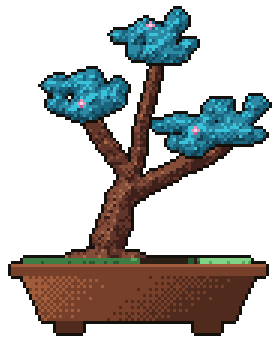

<h2>Hi there, I'm Raghav</h2>
<p><em>
  <b>Robotics team lead at my school</b>
  <br>
  Won RIRC 2026 and PEC Hacks 4.0
  <br>
  Top 5 at ZRC Technoxian 2026 with CRASH
  <br>
  Doing Class 9 in Chennai
</em></p>

<p><em>Currently building <a href="https://github.com/Raghav2012Code/transit-forge">TransitForge</a>, a 3D transit planning sandbox.</em></p>


---

<picture>
  <source media="(max-width: 1400px)" srcset="output/spacer.png">
  
</picture>

### A little more about me...

```javascript
const raghav = {
  pronouns: "he" | "him",
  code: ["C", "C++", "TypeScript",
         "Python", "JavaScript"],
  tools: ["React", "Three.js", "ESP32", "Arduino",
          "Supabase", "VSCodium", "Ollama"],
  system: ["Windows 11", "PowerShell"],
  challenge: "I re-grow a bonsai from my commits every day"
};
```

<em>I build robots and web things — if you want to build something together, say <b>hi</b>!</em>

<a href="https://raghavkrishna-dev.vercel.app/"><picture><source media="(prefers-color-scheme: dark)" srcset="assets/icons/dark/website.svg"></picture></a> <a href="https://x.com/raghav7krishna"><picture><source media="(prefers-color-scheme: dark)" srcset="assets/icons/dark/x.svg"></picture></a> <a href="https://instagram.com/raghav.krishna0505"><picture><source media="(prefers-color-scheme: dark)" srcset="assets/icons/dark/instagram.svg"></picture></a> <a href="https://discord.com/users/980399356148609045"><picture><source media="(prefers-color-scheme: dark)" srcset="assets/icons/dark/discord.svg"></picture></a> <a href="mailto:raghavgamerz670@gmail.com"><picture><source media="(prefers-color-scheme: dark)" srcset="assets/icons/dark/email.svg"></picture></a>
